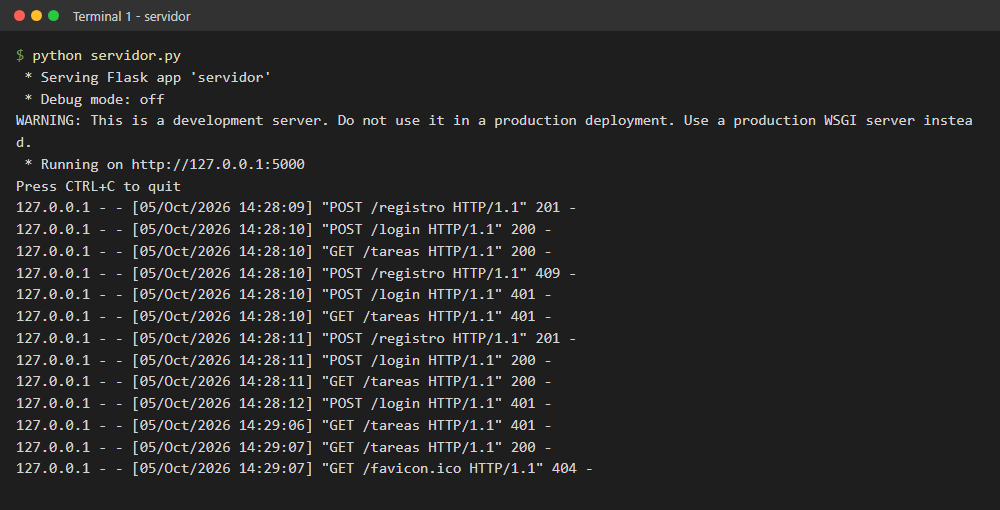
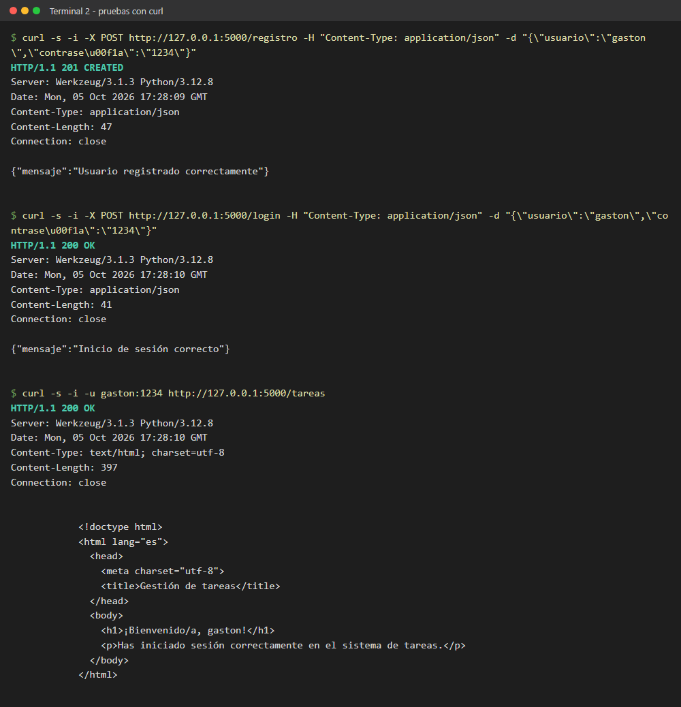
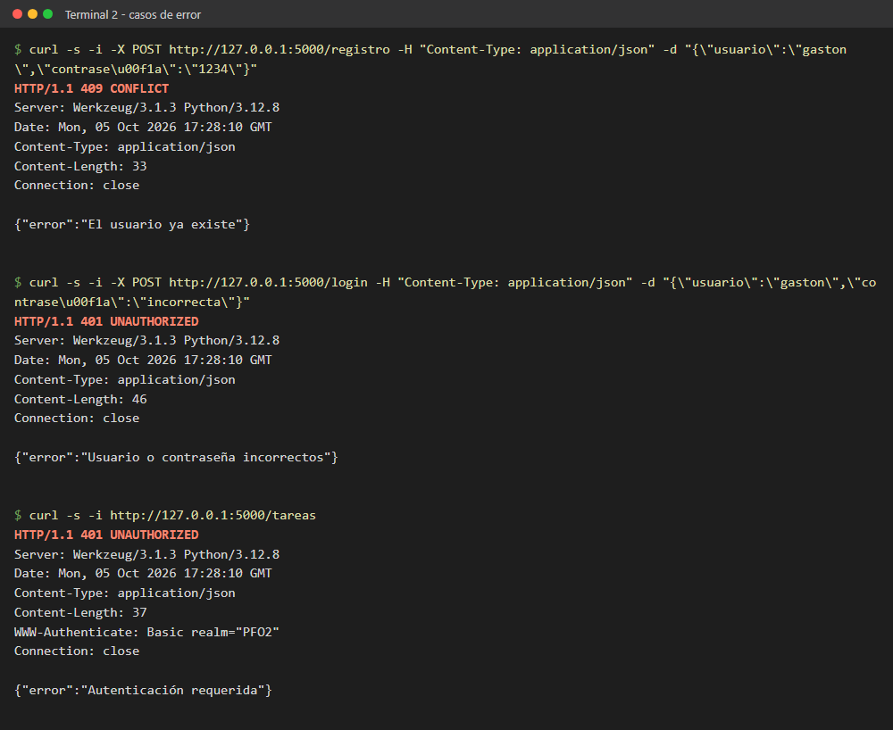
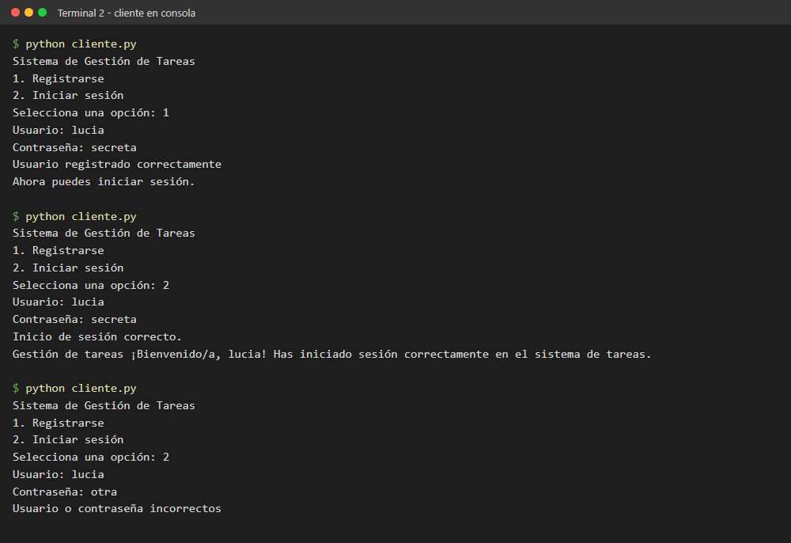
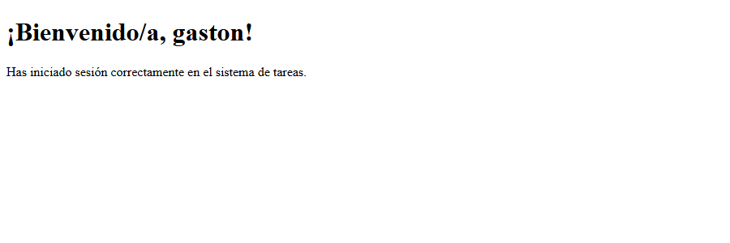
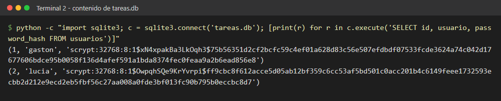
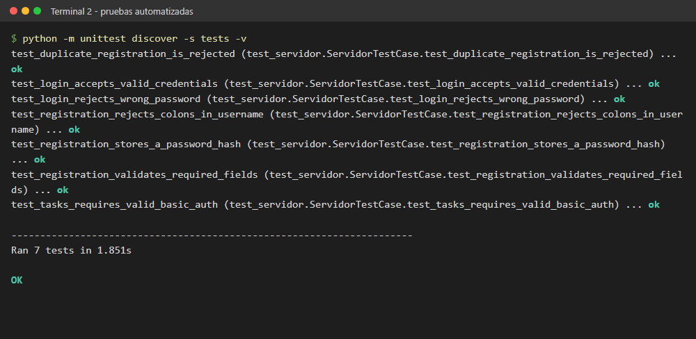

# PFO 2: Sistema de Gestión de Tareas con API y Base de Datos

| | |
|---|---|
| **Alumno** | Gastón Zampar |
| **Materia** | Programación sobre Redes — 3° E |
| **Carrera** | Tecnicatura Superior en Desarrollo de Software |
| **Institución** | IFTS N° 29 |
| **Trabajo** | Práctica Formativa Obligatoria 2 (PFO 2) |

## Descripción

API REST desarrollada con Flask y SQLite. Permite registrar usuarios con
contraseñas hasheadas, validar el inicio de sesión y consultar la página HTML
protegida `/tareas` mediante autenticación HTTP Basic. Incluye además un
cliente en consola que interactúa con la API.

### Objetivos de la práctica

1. Implementar una API REST con endpoints funcionales.
2. Utilizar autenticación básica con protección de contraseñas.
3. Gestionar datos persistentes con SQLite.
4. Construir un cliente en consola que interactúe con la API.

### Endpoints

| Método | Ruta | Descripción | Respuestas |
|---|---|---|---|
| `POST` | `/registro` | Recibe `{"usuario": "nombre", "contraseña": "1234"}` y guarda el usuario con la contraseña hasheada. | `201` creado, `400` datos inválidos, `409` usuario existente |
| `POST` | `/login` | Verifica las credenciales recibidas en el mismo formato JSON. | `200` correcto, `400` datos inválidos, `401` credenciales incorrectas |
| `GET` | `/tareas` | Devuelve un HTML de bienvenida. Requiere autenticación HTTP Basic. | `200` HTML, `401` sin credenciales o incorrectas |

### Estructura del proyecto

```text
PFO2/
├── servidor.py           # API Flask + SQLite
├── cliente.py            # Cliente interactivo en consola
├── requirements.txt      # Dependencias
├── tests/
│   └── test_servidor.py  # Pruebas automatizadas
└── capturas/             # Capturas de las pruebas
```

### Decisiones técnicas

- **Hash de contraseñas:** `werkzeug.security` (`generate_password_hash` /
  `check_password_hash`), que usa scrypt con sal aleatoria.
- **Persistencia:** SQLite mediante el módulo `sqlite3` de la biblioteca
  estándar. La tabla `usuarios` se crea automáticamente al iniciar el servidor.
- **Consultas parametrizadas** para evitar inyección SQL.
- **Autenticación HTTP Basic** en `/tareas`, validada contra los hashes
  almacenados.

## Requisitos

- Python 3.10 o superior.
- pip.

## Instalación

Desde la carpeta del proyecto, crear y activar un entorno virtual e instalar
las dependencias.

En Windows (PowerShell):

```powershell
py -m venv .venv
.\.venv\Scripts\Activate.ps1
python -m pip install -r requirements.txt
```

En macOS o Linux:

```bash
python3 -m venv .venv
source .venv/bin/activate
python -m pip install -r requirements.txt
```

## Ejecución

Iniciar la API desde una terminal:

```bash
python servidor.py
```

El servidor queda disponible en `http://127.0.0.1:5000`. La base de datos `tareas.db` se crea automáticamente junto a `servidor.py`. Para usar otra ruta, se puede definir la variable de entorno `PFO2_DATABASE` antes de iniciar el servidor.

En otra terminal, ejecutar el cliente interactivo:

```bash
python cliente.py
```

El cliente ofrece registro e inicio de sesión y, tras un acceso correcto, consulta `/tareas` y muestra el mensaje de bienvenida.

## Pruebas manuales

En los ejemplos con `curl` la clave JSON `contraseña` se escribe como `contraseña` (escape Unicode estándar de JSON). El servidor la recibe igual, y así se evitan problemas de codificación de la `ñ` en terminales de Windows.

Registrar un usuario (Bash o Git Bash):

```bash
curl -i -X POST http://127.0.0.1:5000/registro \
  -H "Content-Type: application/json" \
  -d '{"usuario":"gaston","contraseña":"1234"}'
```

Iniciar sesión:

```bash
curl -i -X POST http://127.0.0.1:5000/login \
  -H "Content-Type: application/json" \
  -d '{"usuario":"gaston","contraseña":"1234"}'
```

Ver la página de bienvenida (requiere autenticación):

```bash
curl -i -u gaston:1234 http://127.0.0.1:5000/tareas
```

También puede abrirse `http://127.0.0.1:5000/tareas` en el navegador, que solicitará usuario y contraseña.

En PowerShell:

```powershell
$body = @{ usuario = "gaston"; contraseña = "1234" } | ConvertTo-Json
$bytes = [System.Text.Encoding]::UTF8.GetBytes($body)
Invoke-RestMethod -Method Post -Uri http://127.0.0.1:5000/registro `
  -ContentType "application/json" -Body $bytes
Invoke-RestMethod -Method Post -Uri http://127.0.0.1:5000/login `
  -ContentType "application/json" -Body $bytes
curl.exe -u gaston:1234 http://127.0.0.1:5000/tareas
```

## Pruebas automatizadas

```bash
python -m unittest discover -s tests -v
```

Las pruebas usan una base de datos temporal y comprueban que se almacena un hash (y no la contraseña), el rechazo de usuarios duplicados, la validación de campos, el inicio de sesión correcto e incorrecto y la protección de `/tareas`.

## Capturas de pantalla

### 1. Servidor en ejecución

El servidor Flask escucha en `127.0.0.1:5000` y registra cada solicitud recibida durante las pruebas.



### 2. Registro, inicio de sesión y acceso a `/tareas` con curl

Registro (`201 CREATED`), inicio de sesión (`200 OK`) y HTML de bienvenida obtenido con autenticación básica (`200 OK`).



### 3. Validaciones y casos de error

Usuario duplicado (`409`), contraseña incorrecta (`401`) y acceso a `/tareas` sin credenciales (`401`).



### 4. Cliente en consola

Registro de un usuario nuevo, inicio de sesión con visualización del mensaje de bienvenida e intento con contraseña incorrecta.



### 5. Página de bienvenida en el navegador

HTML devuelto por `GET /tareas` tras autenticarse.



### 6. Contraseñas hasheadas en SQLite

Contenido de la tabla `usuarios`: las contraseñas se guardan como hash scrypt con sal, nunca en texto plano.



### 7. Pruebas automatizadas



## Respuestas conceptuales

### ¿Por qué hashear contraseñas?

El hash evita guardar la contraseña original. Si alguien accede a la base de datos, no obtiene directamente las claves de los usuarios, y como un hash no se puede revertir, el servidor solo puede verificar una contraseña volviendo a calcular el hash y comparándolo. Además, muchas personas reutilizan sus contraseñas en otros servicios, por lo que una filtración en texto plano afectaría también a esas cuentas.

El servidor usa `werkzeug.security`, que genera hashes con **sal** (un valor aleatorio distinto por usuario, de modo que dos contraseñas iguales producen hashes diferentes) y con un algoritmo deliberadamente lento (scrypt), lo que dificulta los ataques por fuerza bruta y con tablas precalculadas. Por eso no debe reemplazarse por un hash rápido y sin sal como MD5 o SHA-256.

### Ventajas de usar SQLite en este proyecto

- **Sin servidor:** la base es un único archivo local (`tareas.db`); no hace falta instalar, configurar ni mantener un motor de base de datos aparte.
- **Incluido en Python:** el módulo `sqlite3` forma parte de la biblioteca estándar, por lo que no agrega dependencias.
- **Persistencia real:** los usuarios se conservan entre reinicios del servidor, a diferencia de guardarlos en memoria.
- **SQL estándar y transacciones:** permite usar restricciones como `UNIQUE` para impedir usuarios duplicados y consultas parametrizadas contra inyección SQL.
- **Portabilidad:** el proyecto se puede copiar y ejecutar en cualquier equipo sin configuración adicional, y las pruebas pueden usar bases temporales.

Es una opción adecuada para una aplicación pequeña como esta práctica. Para un sistema con muchas escrituras concurrentes convendría un motor cliente-servidor como PostgreSQL o MySQL.